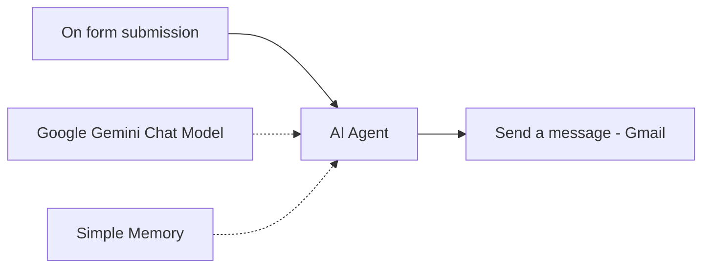

# 🤖 AI Q&A Agent: n8n + Google Gemini

An n8n workflow that turns a simple web form into an AI-powered support assistant. A user submits a question, a Gemini-powered AI agent answers it using your project's context, and the answer is emailed back automatically.


## ✨ What it does

1. **User submits a question** through an n8n-hosted form (question + email).
2. **AI Agent** (Google Gemini) reads the question and answers it, guided by a detailed system prompt describing your project: purpose, stakeholders, scope, roadmap, and success KPIs.
3. **Gmail** sends the answer back to the user in a friendly HTML email.



## 🧩 Nodes used

| Node | Purpose |
|------|---------|
| **On form submission** | Hosts the form and triggers the workflow |
| **AI Agent** | Generates the answer using the system prompt |
| **Google Gemini Chat Model** | The LLM powering the agent |
| **Simple Memory** | Window buffer memory for the agent |
| **Gmail (Send a message)** | Emails the answer to the user |

## 🔧 Requirements

- An [n8n](https://n8n.io) instance (cloud or self-hosted). A recent version is needed because the workflow uses AI Agent node v3.x.
- A **Google Gemini API key** from [Google AI Studio](https://aistudio.google.com/)
- A **Gmail account** connected via OAuth2 in n8n

## 🚀 Setup

1. **Download** `workflow.json` from this repo.
2. In n8n, click **Workflows → Import from File** and select the JSON.
3. **Add your credentials:**
   - *Google Gemini Chat Model* → create a **Google Gemini (PaLM) API** credential with your API key.
   - *Send a message* → connect your **Gmail OAuth2** account.
4. **Customize the system prompt** in the AI Agent node (see below).
5. Click **Execute workflow**, open the form's **Test URL**, and submit a question with your own email.
6. When it works, **activate** the workflow and share the form's **Production URL**.

## ✏️ Customizing

### System prompt
The AI Agent's system message contains a project description with placeholders like `[input/request]` and `[final outcome]`. Replace it with real details about **your** product or team. The quality of the answers depends almost entirely on the context you provide here.

### Memory
The Simple Memory node's session key is currently set to the submitted question. That means each question starts its own session, so follow-ups aren't linked. To let the agent remember a user across questions, change the session key to the user's email:

```
{{ $json.Email }}
```

### Form fields
Edit the form in the **On form submission** node to add fields such as name, category, or priority. Reference them in the agent's prompt using `{{ $json['Field name'] }}`.

### Email template
The email body is plain HTML in the Gmail node. Update the subject and message to match your branding.

## 🛡️ Recommended improvements

- **Human approval:** add a review step (e.g. Slack or email approval) before the answer is sent, especially for high-stakes questions.
- **Logging:** append each question and answer to Google Sheets for tracking.
- **Knowledge base:** connect a vector store (RAG) so the agent answers from your real documents instead of a static prompt.
- **Error handling:** add an error workflow so you're alerted if the AI or Gmail step fails.

## 📁 Repo structure

```
.
├── workflow.json      # Importable n8n workflow
├── screenshots/       # Canvas screenshots
└── README.md
```

## 🔐 Security note

This repo contains no API keys or credentials. You must add your own after importing. Never commit API keys, tokens, or personal email addresses to a public repo.


## 📄 License

MIT. Feel free to use, modify, and share.

---

